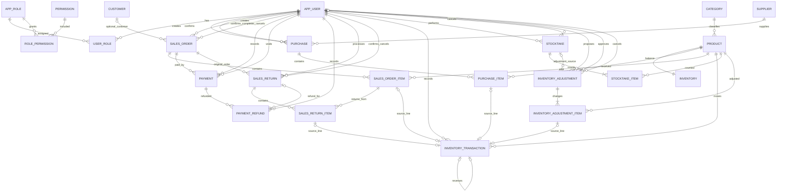

# Thiết kế cơ sở dữ liệu V1 – Computer Store Management

> **Trạng thái:** Baseline thiết kế đề xuất đã được chốt trong tài liệu để làm cơ sở triển khai V1. Các lựa chọn dưới đây được suy luận theo nghiệp vụ cửa hàng bán linh kiện máy tính trực tiếp tại quầy, một cửa hàng và một kho. Nếu nhóm thay đổi phạm vi, cần cập nhật tài liệu và tạo migration mới phù hợp.
>
> **Nguồn yêu cầu:** `project-scope.md` và `requirements.md` (2026-11-09). Tài liệu này chỉ mô tả thiết kế; chưa tạo schema, chưa thêm dependency và chưa kết nối/chạy migration trên MySQL.

## 1. Nguyên tắc và quyết định nền tảng

- MySQL 8.0.46, InnoDB; database dùng mặc định `CHARACTER SET utf8mb4 COLLATE utf8mb4_vi_0900_ai_ci`. Java 21 + Spring Boot + Spring Data JPA/Hibernate trong modular monolith. Một cửa hàng, một kho; mỗi sản phẩm có đúng một dòng `inventory`.
- Hàng hóa V1 được quản lý theo **đơn vị nguyên chiếc**. CPU, RAM, mainboard, VGA, SSD/HDD, PSU, case, màn hình và phụ kiện được tạo thành các SKU riêng biệt. Không hỗ trợ bán theo mét, kg hoặc số lượng thập phân trong V1.
- Đơn vị tiền tệ là **VND**, lưu số nguyên không có phần thập phân bằng `DECIMAL(19,0)`. Không dùng `FLOAT`/`DOUBLE` cho tiền.
- Sản phẩm có `sku` riêng cho từng biến thể bán được. Ví dụ RAM Kingston 16GB DDR5 và RAM Kingston 32GB DDR5 là hai sản phẩm/SKU khác nhau. Lưu thêm thương hiệu và mã model để tìm kiếm, phân biệt linh kiện; không xây module quản lý thương hiệu riêng trong V1.
- V1 không áp dụng chiết khấu. Tổng tiền đơn bán bằng tổng thành tiền các dòng. Giá bán được chụp tại thời điểm xác nhận đơn; giá nhập được chụp trên từng dòng phiếu nhập.
- Không triển khai báo cáo lợi nhuận trong V1 vì chưa có costing theo lô/FIFO/weighted average. Báo cáo V1 tập trung doanh thu thuần theo đơn đã hoàn tất trừ giá trị hàng trả đã xác nhận, số lượng bán/đã trả, tồn hiện tại, tồn thấp và lịch sử nhập-xuất. Đơn bị hủy không tính doanh thu; không dùng cash refunds để trừ doanh thu lần nữa vì giá trị return đã làm giảm doanh thu.
- Khách hàng là hồ sơ giao dịch tùy chọn, không có tài khoản đăng nhập. Không có giỏ hàng, checkout online, giao hàng, cổng thanh toán, serial/IMEI, bảo hành, multi-branch hoặc multi-warehouse.
- Chứng từ đã tác động tồn kho và inventory movement là lịch sử bất biến; không xóa vật lý. Dữ liệu danh mục/đối tác/người dùng được chuyển inactive/locked khi đã có tham chiếu.
- `inventory.quantity_on_hand` là số dư đọc nhanh; `inventory_transaction` là sổ biến động bất biến. Không có endpoint CRUD trực tiếp cho số dư. Mọi thay đổi tồn kho phải đi qua nghiệp vụ hợp lệ và cập nhật số dư + movement trong cùng database transaction.
- Trạng thái đơn hàng tách biệt trạng thái thanh toán. Payment status được tính từ tiền thực thu trừ tiền đã refund, so với giá trị đơn còn phải thu sau khi trừ các return đã xác nhận; không lưu một giá trị độc lập dễ lệch.
- Khóa chính dùng `BIGINT UNSIGNED`; các FK dùng đúng cùng kiểu/signedness. Business key được UNIQUE theo collation đã chốt. Timestamp lưu UTC bằng `DATETIME(6)`; tầng ứng dụng chuyển đổi múi giờ.

### 1.1. Quy ước dữ liệu sản phẩm linh kiện

- `sku` đại diện cho một biến thể hàng hóa có thể nhập, tồn và bán độc lập; không gộp các dung lượng/tốc độ/socket/model khác nhau vào cùng SKU.
- `brand_name` và `model_code` là thuộc tính văn bản tùy chọn trên `product`, đủ dùng cho V1 và tránh phát sinh module CRUD thương hiệu ngoài scope.
- Thông số kỹ thuật đặc thù (socket CPU, dung lượng RAM, chuẩn SSD, chipset, công suất PSU...) được mô tả trong `description` ở V1. Không tạo một bảng thuộc tính EAV phức tạp vì mỗi nhóm linh kiện có bộ thông số khác nhau.
- Danh mục gợi ý để seed dữ liệu ban đầu: CPU, Mainboard, RAM, VGA, SSD, HDD, PSU, Case, Cooling, Monitor, Peripheral, Network, Cable & Accessory. Đây là dữ liệu tham chiếu, không phải các bảng riêng.

### 1.2. Character set, collation và chuẩn hóa khóa

Toàn bộ database, table và cột văn bản mặc định dùng `utf8mb4` / `utf8mb4_vi_0900_ai_ci`. Collation tiếng Việt này không phân biệt dấu và chữ hoa/thường, phù hợp cho tên, thương hiệu, địa chỉ, ghi chú và nội dung tự do. Các cột định danh liệt kê dưới đây override thành `utf8mb4_0900_bin`: UNIQUE trên chúng so sánh chính xác từng ký tự sau chuẩn hóa, không tự gộp khác hoa/thường hoặc dấu. Tham khảo [MySQL 8.0 Unicode collations](https://dev.mysql.com/doc/refman/8.0/en/charset-unicode-sets.html).

Quy tắc chuẩn hóa ở service áp dụng trước cả kiểm tra UNIQUE và lưu dữ liệu:

- `product.sku`, `category.code`, `supplier.code`, `customer.code`, `app_role.code`, `permission.code`, `purchase.document_no`, `sales_order.order_no`, `payment.payment_no`, `payment_refund.refund_no`, `sales_return.return_no`, `stocktake.stocktake_no`, `inventory_adjustment.adjustment_no`: trim khoảng trắng đầu/cuối ASCII; chuyển thành uppercase ASCII; chỉ cho phép `[A-Z0-9._-]`; không cho dấu, ký tự Unicode hay khoảng trắng bên trong.
- `app_user.username`: trim khoảng trắng đầu/cuối ASCII; chuyển thành lowercase ASCII; chỉ cho phép `[a-z0-9._-]`; không cho dấu/ký tự Unicode hoặc khoảng trắng bên trong.
- `app_user.email`: trim khoảng trắng đầu/cuối ASCII; chấp nhận địa chỉ ASCII hợp lệ và chuyển toàn bộ địa chỉ thành lowercase ASCII (đây là quy tắc định danh ứng dụng); không cho khoảng trắng bên trong hoặc ký tự Unicode.
- Sau chuẩn hóa, nếu giá trị trùng với bản ghi hiện có theo UNIQUE thì từ chối thao tác với lỗi xung đột; không tự ghi đè, gộp bản ghi hay đổi mã. Khi nhập dữ liệu ban đầu, các xung đột sau chuẩn hóa phải được giải quyết thủ công trước khi nạp.
- Văn bản tự nhiên giữ Unicode; chỉ trim khoảng trắng đầu/cuối, không đổi hoa/thường hoặc bỏ dấu. Collation mặc định điều khiển so sánh/tìm kiếm văn bản đó.

**Collation override theo cột:** `utf8mb4_0900_bin` trên `product.sku`; `app_user.username`, `app_user.email`; `app_role.code`; `permission.code`; `category.code`; `supplier.code`; `customer.code`; `purchase.document_no`; `sales_order.order_no`; `payment.payment_no`; `payment_refund.refund_no`; `sales_return.return_no`; `stocktake.stocktake_no`; `inventory_adjustment.adjustment_no`. Những cột này giữ UNIQUE đã liệt kê trong bảng tương ứng; các cột email tùy chọn chỉ áp dụng cho `app_user.email` UNIQUE (nhiều NULL được phép). Email của supplier/customer không UNIQUE theo thiết kế V1.
## 2. ERD đề xuất

Mỗi movement gốc tham chiếu đúng một dòng nguồn qua một trong bốn FK nullable (`purchase_item_id`, `sales_order_item_id`, `sales_return_item_id`, `adjustment_item_id`). Movement đảo không tham chiếu lại dòng nguồn mà dùng `reversal_of_transaction_id`. CHECK biểu diễn hai trường hợp loại trừ nhau bằng các predicate NULL-safe: (a) `reversal_of_transaction_id IS NULL`, đúng một source FK IS NOT NULL và `reversal_reason IS NULL`; hoặc (b) `reversal_of_transaction_id IS NOT NULL`, cả bốn source FK IS NULL và `reversal_reason IS NOT NULL`. Không so sánh nullable FK trực tiếp với giá trị, nên CHECK không thể thành UNKNOWN và cho lọt row. UNIQUE riêng trên từng FK nguồn bảo đảm một dòng nguồn chỉ sinh tối đa một movement gốc. UNIQUE trên `reversal_of_transaction_id` bảo đảm một movement chỉ bị đảo toàn phần tối đa một lần. MySQL cho phép nhiều giá trị NULL trong UNIQUE index.

Các quy tắc so khớp `product_id`, `transaction_type`, dấu/độ lớn `quantity_delta`, điều kiện được phép đảo và tổng hợp refund/return cần được kiểm tra trong service transaction; CHECK thông thường không thể kiểm tra dữ liệu ở bảng khác hoặc tổng nhiều dòng. Thiết kế V1 không lưu product_id dư trong return item. Vì vậy database kiểm tra FK nguồn tồn tại nhưng service phải xác nhận product_id khớp với product dòng nguồn (đặc biệt return); không dùng trigger. Composite FK chỉ được chọn nếu thêm product_id dư vào dòng nguồn và unique key ghép tương ứng, hiện không cần cho V1.

## 3. Danh sách bảng và cột

Quy ước MySQL áp dụng cho mọi bảng: `id BIGINT UNSIGNED NOT NULL AUTO_INCREMENT PRIMARY KEY`; mọi cột được liệt kê trong bảng dưới đây đều ghi tường minh `NOT NULL` hoặc `NULL`. Không có cột ngầm định ngoài `id` và các cột audit được liệt kê. PK/FK ID luôn cùng kiểu `BIGINT UNSIGNED`. Các dòng chi tiết có thể sửa khi chứng từ còn nháp có `created_at` và `updated_at`; event lịch sử bất biến chỉ có `created_at`. Các timestamp là `DATETIME(6) NOT NULL` trừ khi đánh dấu `NULL`, lưu UTC.

### 3.1. Tài khoản và phân quyền

| Bảng | Cột ngoài `id` | Ràng buộc / index |
|---|---|---|
| `app_user` | `username VARCHAR(100) COLLATE utf8mb4_0900_bin NOT NULL`, `password_hash VARCHAR(255) NOT NULL`, `full_name VARCHAR(150) NOT NULL`, `email VARCHAR(254) COLLATE utf8mb4_0900_bin NULL`, `phone VARCHAR(30) NULL`, `is_active BOOLEAN NOT NULL DEFAULT TRUE`, `last_login_at DATETIME(6) NULL`, `created_at DATETIME(6) NOT NULL`, `updated_at DATETIME(6) NOT NULL` | UNIQUE(`username`), UNIQUE(`email`); nhiều NULL email được phép. CHECK `is_active IN (0,1)`. Mật khẩu chỉ lưu hash. |
| `app_role` | `code VARCHAR(50) COLLATE utf8mb4_0900_bin NOT NULL`, `name VARCHAR(100) NOT NULL`, `description VARCHAR(255) NULL`, `created_at DATETIME(6) NOT NULL`, `updated_at DATETIME(6) NOT NULL` | UNIQUE(`code`); seed ADMIN, MANAGER, SALES_STAFF, WAREHOUSE_STAFF. |
| `permission` | `code VARCHAR(100) COLLATE utf8mb4_0900_bin NOT NULL`, `name VARCHAR(120) NOT NULL`, `description VARCHAR(255) NULL`, `created_at DATETIME(6) NOT NULL`, `updated_at DATETIME(6) NOT NULL` | UNIQUE(`code`); permission codes được seed theo ma trận quyền API/security. |
| `user_role` | `user_id BIGINT UNSIGNED NOT NULL`, `role_id BIGINT UNSIGNED NOT NULL`, `assigned_at DATETIME(6) NOT NULL` | UNIQUE(`user_id`,`role_id`); FK user/role ON DELETE RESTRICT. `assigned_at` là thời điểm tạo liên kết. |
| `role_permission` | `role_id BIGINT UNSIGNED NOT NULL`, `permission_id BIGINT UNSIGNED NOT NULL`, `created_at DATETIME(6) NOT NULL` | UNIQUE(`role_id`,`permission_id`); FK role/permission ON DELETE RESTRICT. |

### 3.2. Danh mục, sản phẩm, đối tác và số dư kho

| Bảng | Cột ngoài `id` | Ràng buộc / index |
|---|---|---|
| `category` | `code VARCHAR(50) COLLATE utf8mb4_0900_bin NOT NULL`, `name VARCHAR(120) NOT NULL`, `description VARCHAR(500) NULL`, `is_active BOOLEAN NOT NULL DEFAULT TRUE`, `created_at DATETIME(6) NOT NULL`, `updated_at DATETIME(6) NOT NULL` | UNIQUE(`code`); CHECK `is_active IN (0,1)`; INDEX(`is_active`,`name`). |
| `product` | `sku VARCHAR(64) COLLATE utf8mb4_0900_bin NOT NULL`, `name VARCHAR(200) NOT NULL`, `brand_name VARCHAR(100) NULL`, `model_code VARCHAR(100) NULL`, `description TEXT NULL`, `category_id BIGINT UNSIGNED NOT NULL`, `selling_price DECIMAL(19,0) NOT NULL`, `min_stock_level BIGINT NOT NULL DEFAULT 0`, `is_active BOOLEAN NOT NULL DEFAULT TRUE`, `created_at DATETIME(6) NOT NULL`, `updated_at DATETIME(6) NOT NULL` | UNIQUE(`sku`); FK category RESTRICT; CHECK `selling_price >= 0`, `min_stock_level >= 0`, `is_active IN (0,1)`; INDEX(`category_id`,`is_active`), INDEX(`name`), INDEX(`brand_name`), INDEX(`model_code`). Không lưu giá nhập master; giá nhập nằm trên từng dòng purchase. |
| `supplier` | `code VARCHAR(50) COLLATE utf8mb4_0900_bin NOT NULL`, `name VARCHAR(200) NOT NULL`, `phone VARCHAR(30) NULL`, `email VARCHAR(254) NULL`, `address VARCHAR(500) NULL`, `notes TEXT NULL`, `is_active BOOLEAN NOT NULL DEFAULT TRUE`, `created_at DATETIME(6) NOT NULL`, `updated_at DATETIME(6) NOT NULL` | UNIQUE(`code`); CHECK `is_active IN (0,1)`; INDEX(`name`), INDEX(`is_active`). |
| `customer` | `code VARCHAR(50) COLLATE utf8mb4_0900_bin NOT NULL`, `full_name VARCHAR(150) NOT NULL`, `phone VARCHAR(30) NULL`, `email VARCHAR(254) NULL`, `address VARCHAR(500) NULL`, `notes TEXT NULL`, `is_active BOOLEAN NOT NULL DEFAULT TRUE`, `created_at DATETIME(6) NOT NULL`, `updated_at DATETIME(6) NOT NULL` | UNIQUE(`code`); CHECK `is_active IN (0,1)`; INDEX(`phone`), INDEX(`full_name`). Phone/email không unique. |
| `inventory` | `product_id BIGINT UNSIGNED NOT NULL`, `quantity_on_hand BIGINT NOT NULL DEFAULT 0`, `version BIGINT NOT NULL DEFAULT 0`, `created_at DATETIME(6) NOT NULL`, `updated_at DATETIME(6) NOT NULL` | UNIQUE(`product_id`); FK product RESTRICT; CHECK `quantity_on_hand >= 0`, `version >= 0`. Mỗi product đúng một số dư. |

### 3.3. Nhập hàng

| Bảng | Cột ngoài `id` | Ràng buộc / index |
|---|---|---|
| `purchase` | `document_no VARCHAR(40) COLLATE utf8mb4_0900_bin NOT NULL`, `supplier_id BIGINT UNSIGNED NOT NULL`, `status VARCHAR(20) NOT NULL`, `created_by BIGINT UNSIGNED NOT NULL`, `confirmed_by BIGINT UNSIGNED NULL`, `confirmed_at DATETIME(6) NULL`, `notes VARCHAR(1000) NULL`, `cancelled_at DATETIME(6) NULL`, `cancelled_by BIGINT UNSIGNED NULL`, `cancel_reason VARCHAR(500) NULL`, `total_amount DECIMAL(19,0) NOT NULL DEFAULT 0`, `created_at DATETIME(6) NOT NULL`, `updated_at DATETIME(6) NOT NULL` | UNIQUE(`document_no`); FK supplier/created_by/confirmed_by/cancelled_by RESTRICT; CHECK status thuộc DRAFT/CONFIRMED/CANCELLED; CHECK confirmed_by và confirmed_at đồng thời NULL hoặc NOT NULL; CHECK CANCELLED yêu cầu cancelled_by/at/reason NOT NULL. INDEX(`status`,`created_at`), INDEX(`supplier_id`,`created_at`). Warehouse Staff xác nhận; Manager chỉ xem. |
| `purchase_item` | `purchase_id BIGINT UNSIGNED NOT NULL`, `product_id BIGINT UNSIGNED NOT NULL`, `product_name_snapshot VARCHAR(200) NOT NULL`, `sku_snapshot VARCHAR(64) NOT NULL`, `quantity BIGINT NOT NULL`, `unit_cost DECIMAL(19,0) NOT NULL`, `line_total DECIMAL(19,0) NOT NULL`, `created_at DATETIME(6) NOT NULL`, `updated_at DATETIME(6) NOT NULL` | FK purchase/product RESTRICT; CHECK `quantity > 0`, `unit_cost >= 0`, `line_total >= 0`; UNIQUE(`purchase_id`,`product_id`) — một SKU một dòng/phiếu; index UNIQUE đã cover `purchase_id`, thêm INDEX(`product_id`). Tên/SKU và giá nhập được snapshot. |

### 3.4. Bán hàng, thanh toán, hoàn tiền và trả hàng

| Bảng | Cột ngoài `id` | Ràng buộc / index |
|---|---|---|
| `sales_order` | `order_no VARCHAR(40) COLLATE utf8mb4_0900_bin NOT NULL`, `customer_id BIGINT UNSIGNED NULL`, `status VARCHAR(20) NOT NULL`, `created_by BIGINT UNSIGNED NOT NULL`, `confirmed_by BIGINT UNSIGNED NULL`, `confirmed_at DATETIME(6) NULL`, `completed_at DATETIME(6) NULL`, `completed_by BIGINT UNSIGNED NULL`, `cancelled_at DATETIME(6) NULL`, `cancelled_by BIGINT UNSIGNED NULL`, `cancel_reason VARCHAR(500) NULL`, `total_amount DECIMAL(19,0) NOT NULL DEFAULT 0`, `notes VARCHAR(1000) NULL`, `created_at DATETIME(6) NOT NULL`, `updated_at DATETIME(6) NOT NULL` | UNIQUE(`order_no`); FK customer/actors RESTRICT; CHECK status thuộc DRAFT/CONFIRMED/COMPLETED/CANCELLED, total >= 0; actor/time cặp xác nhận/hoàn tất/hủy đồng bộ; CANCELLED cần actor/time/reason. INDEX(`status`,`created_at`), INDEX(`customer_id`,`created_at`). Không discount; total được tính từ line trong service transaction. |
| `sales_order_item` | `order_id BIGINT UNSIGNED NOT NULL`, `product_id BIGINT UNSIGNED NOT NULL`, `product_name_snapshot VARCHAR(200) NOT NULL`, `sku_snapshot VARCHAR(64) NOT NULL`, `brand_snapshot VARCHAR(100) NULL`, `model_snapshot VARCHAR(100) NULL`, `quantity BIGINT NOT NULL`, `unit_price DECIMAL(19,0) NOT NULL`, `line_total DECIMAL(19,0) NOT NULL`, `created_at DATETIME(6) NOT NULL`, `updated_at DATETIME(6) NOT NULL` | FK order/product RESTRICT; CHECK quantity > 0, unit_price/line_total >= 0; UNIQUE(`order_id`,`product_id`) — một SKU một dòng/đơn; unique đã cover `order_id`, thêm INDEX(`product_id`). Service tính `line_total = quantity * unit_price`; snapshots chốt khi xác nhận. |
| `payment` | `payment_no VARCHAR(40) COLLATE utf8mb4_0900_bin NOT NULL`, `order_id BIGINT UNSIGNED NOT NULL`, `amount DECIMAL(19,0) NOT NULL`, `method VARCHAR(30) NOT NULL`, `status VARCHAR(20) NOT NULL`, `paid_at DATETIME(6) NOT NULL`, `recorded_by BIGINT UNSIGNED NOT NULL`, `voided_at DATETIME(6) NULL`, `voided_by BIGINT UNSIGNED NULL`, `void_reason VARCHAR(500) NULL`, `reference_note VARCHAR(255) NULL`, `created_at DATETIME(6) NOT NULL`, `updated_at DATETIME(6) NOT NULL` | UNIQUE(`payment_no`); FK order/actors RESTRICT; CHECK amount > 0, method CASH/BANK_TRANSFER/CARD, status RECORDED/VOIDED. CHECK RECORDED yêu cầu toàn bộ trường void NULL; VOIDED yêu cầu voided_at/by/reason NOT NULL. INDEX(`order_id`,`paid_at`). Chỉ RECORDED được tính tiền thu. |
| `payment_refund` | `refund_no VARCHAR(40) COLLATE utf8mb4_0900_bin NOT NULL`, `payment_id BIGINT UNSIGNED NOT NULL`, `return_id BIGINT UNSIGNED NULL`, `amount DECIMAL(19,0) NOT NULL`, `method VARCHAR(30) NOT NULL`, `refunded_at DATETIME(6) NOT NULL`, `refunded_by BIGINT UNSIGNED NOT NULL`, `reason VARCHAR(500) NOT NULL`, `created_at DATETIME(6) NOT NULL` | UNIQUE(`refund_no`); FK payment/return/user RESTRICT; CHECK amount > 0, method CASH/BANK_TRANSFER/CARD. INDEX(`payment_id`,`refunded_at`), INDEX(`return_id`). `return_id` NULL chỉ cho refund hủy đơn; khi có return_id service xác thực return thuộc order của payment. |
| `sales_return` | `return_no VARCHAR(40) COLLATE utf8mb4_0900_bin NOT NULL`, `order_id BIGINT UNSIGNED NOT NULL`, `status VARCHAR(20) NOT NULL`, `reason VARCHAR(500) NOT NULL`, `created_by BIGINT UNSIGNED NOT NULL`, `confirmed_by BIGINT UNSIGNED NULL`, `confirmed_at DATETIME(6) NULL`, `cancelled_at DATETIME(6) NULL`, `cancelled_by BIGINT UNSIGNED NULL`, `cancel_reason VARCHAR(500) NULL`, `created_at DATETIME(6) NOT NULL`, `updated_at DATETIME(6) NOT NULL` | UNIQUE(`return_no`); FK order/actors RESTRICT; CHECK status DRAFT/CONFIRMED/CANCELLED; CHECK confirmed_by/at đồng thời NULL hoặc NOT NULL; CANCELLED cần cancelled_by/at/reason. INDEX(`order_id`,`status`), INDEX(`created_at`). Tổng giá trị tính từ lines, không lưu trùng. |
| `sales_return_item` | `return_id BIGINT UNSIGNED NOT NULL`, `sales_order_item_id BIGINT UNSIGNED NOT NULL`, `quantity BIGINT NOT NULL`, `restock_quantity BIGINT NOT NULL DEFAULT 0`, `unit_refund_amount DECIMAL(19,0) NOT NULL`, `created_at DATETIME(6) NOT NULL`, `updated_at DATETIME(6) NOT NULL` | FK return/order item RESTRICT; CHECK quantity > 0, restock_quantity >= 0 AND restock_quantity <= quantity, unit_refund_amount >= 0; UNIQUE(`return_id`,`sales_order_item_id`); index UNIQUE đã cover return_id, thêm INDEX(`sales_order_item_id`). Không lưu product_id suy ra từ order item. Service buộc đơn giá refund bằng giá snapshot gốc. |

### 3.5. Kiểm kê, điều chỉnh và nhật ký kho

| Bảng | Cột ngoài `id` | Ràng buộc / index |
|---|---|---|
| `stocktake` | `stocktake_no VARCHAR(40) COLLATE utf8mb4_0900_bin NOT NULL`, `status VARCHAR(20) NOT NULL`, `performed_by BIGINT UNSIGNED NOT NULL`, `started_at DATETIME(6) NOT NULL`, `completed_at DATETIME(6) NULL`, `cancelled_at DATETIME(6) NULL`, `cancelled_by BIGINT UNSIGNED NULL`, `cancel_reason VARCHAR(500) NULL`, `notes VARCHAR(1000) NULL`, `created_at DATETIME(6) NOT NULL`, `updated_at DATETIME(6) NOT NULL` | UNIQUE(`stocktake_no`); FK performer/canceller RESTRICT; CHECK status IN_PROGRESS/PENDING_APPROVAL/COMPLETED/CANCELLED; CANCELLED cần actor/time/reason. INDEX(`status`,`started_at`). |
| `stocktake_item` | `stocktake_id BIGINT UNSIGNED NOT NULL`, `product_id BIGINT UNSIGNED NOT NULL`, `system_quantity BIGINT NOT NULL`, `snapshot_at DATETIME(6) NOT NULL`, `counted_quantity BIGINT NULL`, `counted_at DATETIME(6) NULL`, `created_at DATETIME(6) NOT NULL`, `updated_at DATETIME(6) NOT NULL` | FK stocktake/product RESTRICT; UNIQUE(`stocktake_id`,`product_id`); CHECK system_quantity >= 0, counted_quantity IS NULL OR counted_quantity >= 0; CHECK counted_quantity IS NULL iff counted_at IS NULL. Variance tính, không lưu. |
| `inventory_adjustment` | `adjustment_no VARCHAR(40) COLLATE utf8mb4_0900_bin NOT NULL`, `status VARCHAR(20) NOT NULL`, `reason VARCHAR(500) NOT NULL`, `proposed_by BIGINT UNSIGNED NOT NULL`, `approved_by BIGINT UNSIGNED NULL`, `proposed_at DATETIME(6) NOT NULL`, `approved_at DATETIME(6) NULL`, `cancelled_at DATETIME(6) NULL`, `cancelled_by BIGINT UNSIGNED NULL`, `cancel_reason VARCHAR(500) NULL`, `stocktake_id BIGINT UNSIGNED NULL`, `created_at DATETIME(6) NOT NULL`, `updated_at DATETIME(6) NOT NULL` | UNIQUE(`adjustment_no`); FK actors/stocktake RESTRICT; CHECK status PENDING/APPROVED/REJECTED/CANCELLED; approver/time pair NULL-ness agrees and approver <> proposer; CANCELLED requires cancel actor/time/reason. INDEX(`status`,`proposed_at`). |
| `inventory_adjustment_item` | `adjustment_id BIGINT UNSIGNED NOT NULL`, `product_id BIGINT UNSIGNED NOT NULL`, `quantity_delta BIGINT NOT NULL`, `created_at DATETIME(6) NOT NULL`, `updated_at DATETIME(6) NOT NULL` | FK adjustment/product RESTRICT; UNIQUE(`adjustment_id`,`product_id`); CHECK quantity_delta <> 0; INDEX(`product_id`). |
| `inventory_transaction` | `product_id BIGINT UNSIGNED NOT NULL`, `transaction_type VARCHAR(30) NOT NULL`, `quantity_delta BIGINT NOT NULL`, `quantity_after BIGINT NOT NULL`, `occurred_at DATETIME(6) NOT NULL`, `recorded_by BIGINT UNSIGNED NOT NULL`, `purchase_item_id BIGINT UNSIGNED NULL`, `sales_order_item_id BIGINT UNSIGNED NULL`, `sales_return_item_id BIGINT UNSIGNED NULL`, `adjustment_item_id BIGINT UNSIGNED NULL`, `reversal_of_transaction_id BIGINT UNSIGNED NULL`, `reversal_reason VARCHAR(500) NULL`, `note VARCHAR(500) NULL`, `created_at DATETIME(6) NOT NULL` | FK product/user/source/self RESTRICT; CHECK quantity_delta <> 0, quantity_after >= 0; CHECK đúng một source FK khi movement gốc hoặc chỉ reversal FK khi movement đảo (mọi test dùng IS NULL/IS NOT NULL để CHECK không trả UNKNOWN); UNIQUE riêng từng source FK và UNIQUE(reversal_of_transaction_id); INDEX(`product_id`,`occurred_at`), INDEX(`transaction_type`,`occurred_at`). Type/source/sign và product/source khớp nhau được service xác thực. |

`NULL` được dùng có chủ đích ở các cột tùy chọn và FK tùy chọn: thông tin liên hệ/description; customer của order; actor/time chưa đến của transition; payment void fields khi RECORDED; refund return_id khi hủy đơn; stocktake count chưa nhập; stocktake_id của adjustment thường; các FK source/reversal của inventory transaction. Mọi cột khác, bao gồm mọi status, amount, quantity, business key và FK bắt buộc, là `NOT NULL` như ghi trên. PK tất cả bảng là cột `id` chung đã nêu; không bảng nào thiếu PK.
## 4. Business rules V1 được áp dụng trong thiết kế

### 4.1. Nhập hàng

- Phiếu nhập có trạng thái `DRAFT → CONFIRMED`; chỉ Warehouse Staff được tạo/sửa/xác nhận theo ma trận quyền.
- Phiếu DRAFT phải có nhà cung cấp, ít nhất một dòng hợp lệ và số lượng nguyên dương. Giá nhập được lưu tại `purchase_item.unit_cost`; `purchase.total_amount` bằng tổng `purchase_item.line_total`.
- Khi xác nhận: kiểm tra supplier và mọi product còn active; khóa các dòng inventory theo `product_id` tăng dần, cộng tồn, tạo đúng một `PURCHASE_IN` cho mỗi dòng nhập và chuyển trạng thái trong cùng transaction.
- Phiếu CONFIRMED không sửa/xóa và không hủy trực tiếp. Phiếu CANCELLED chỉ được chuyển từ DRAFT. Sai lệch phát sinh sau nhập được xử lý bằng đề xuất điều chỉnh kho có Manager duyệt; không viết lại lịch sử phiếu nhập.

### 4.2. Bán hàng và vòng đời đơn

- `OrderStatus`: `DRAFT | CONFIRMED | COMPLETED | CANCELLED`. Payment chỉ được ghi nhận khi order CONFIRMED hoặc COMPLETED; không nhận payment cho DRAFT/CANCELLED.
- `PaymentStatus` là trạng thái suy ra: `UNPAID | PARTIALLY_PAID | PAID`.
- `DRAFT → CONFIRMED`: Sales Staff xác nhận; hệ thống kiểm tra tồn đủ cho toàn đơn, chụp giá bán và thông tin sản phẩm, trừ kho, tạo `SALE_OUT` cho từng dòng và đổi trạng thái trong một transaction. Sản phẩm phải active lúc xác nhận; sản phẩm inactive không thể được thêm vào/chốt ở phiếu nhập hoặc đơn bán.
- `CONFIRMED → COMPLETED`: chỉ khi hàng đã được bàn giao thực tế cho khách tại quầy; lưu `completed_at` và `completed_by`. Hoàn tất độc lập với việc đơn đã thu đủ tiền hay chưa.
- `DRAFT → CANCELLED`: được phép, không phát sinh movement.
- `CONFIRMED → CANCELLED`: chỉ được phép trước khi bàn giao hàng. Hệ thống phải tạo movement `SALE_CANCEL_IN` đảo toàn bộ từng `SALE_OUT` gốc, tăng tồn lại và ghi lý do/actor/time. Không cho đảo một phần bằng thao tác hủy; nếu hàng đã bàn giao thì dùng nghiệp vụ trả hàng.
- `COMPLETED` không được hủy. Mọi hàng trả sau bàn giao phải đi qua `sales_return`.
- Không cho bán vượt tồn. Sản phẩm inactive không được thêm/chốt ở đơn; sản phẩm inactive cũng không được nhận trên phiếu nhập (kể cả DRAFT đã tạo trước khi product inactive). Return/reversal/adjustment là luồng điều chỉnh lịch sử/tồn riêng, không phải nhập mua/bán mới. Các dòng inventory được khóa theo product_id tăng dần hoặc dùng conditional update `quantity_on_hand >= requested`; nếu một sản phẩm thiếu hàng thì rollback toàn đơn.

### 4.3. Thanh toán và hoàn tiền

- Phương thức V1: `CASH`, `BANK_TRANSFER`, `CARD` (thẻ chỉ được ghi nhận ngoại tuyến tại quầy). Không lưu số thẻ, CVV hay tích hợp gateway.
- Giá trị đơn còn phải thu = `sales_order.total_amount` trừ tổng giá trị các dòng `sales_return_item` của return CONFIRMED. Tiền thực thu ròng = tổng payment RECORDED trừ tổng payment_refund. Với đơn chưa CANCELLED, tiền thực thu ròng không được vượt giá trị đơn còn phải thu; payment status so sánh hai giá trị này. Đơn CANCELLED hiển thị payment status là NOT_APPLICABLE; đây là giá trị suy ra, không lưu trong payment hoặc order status.
- `VOIDED` chỉ dùng để sửa bản ghi nhập nhầm khi tiền chưa thực sự được thu. Nếu tiền đã thu và cần trả lại khách, phải tạo `payment_refund`, không void payment.
- Refund là dòng sự kiện dương liên kết payment gốc; tổng refund của một payment không vượt amount gốc. Refund cho trả hàng liên kết `sales_return`; refund do hủy đơn không có return_id. Khi xác nhận return, refund ghi đồng thời trong cùng service transaction và bằng đúng tổng giá trị return lines; không lưu refund total dư thừa ở header.
- Ghi nhận payment/refund phải khóa payment/order liên quan và kiểm tra tổng aggregate trong cùng transaction để tránh hai thao tác đồng thời gây overpayment/over-refund.

### 4.4. Trả hàng

- Chỉ nhận trả đối với đơn `COMPLETED`, trong vòng **7 ngày lịch** kể từ thời điểm hoàn tất và đơn đã thanh toán đủ. Đây là chính sách V1 gọn, dễ kiểm thử; không phải hệ thống bảo hành.
- Số lượng trả cộng dồn theo từng `sales_order_item` không được vượt số lượng đã bán. Mỗi return chỉ được xác nhận một lần; chỉ DRAFT được hủy, CONFIRMED là bất biến.
- Giá trị hoàn theo đúng `unit_price` snapshot trên đơn gốc; không tự tính theo giá bán hiện tại.
- Khi kiểm tra hàng trả: hàng còn nguyên/đủ điều kiện bán lại thì `restock_quantity = quantity`; hàng lỗi, thiếu phụ kiện hoặc không thể bán lại thì `restock_quantity = 0` cho phần tương ứng. Chỉ phần restock mới tạo `RETURN_IN` và tăng tồn. V1 không quản lý quy trình sửa chữa/bảo hành/hàng chờ kiểm định.
- Refund được ghi bằng `payment_refund` và phải liên kết với payment gốc. Khi xác nhận return, tổng các refund gắn với return phải bằng tổng `quantity * unit_refund_amount` của các dòng return; các dòng refund có thể tách theo nhiều payment gốc nếu khách đã thanh toán bằng nhiều lần/phương thức.

### 4.5. Kiểm kê và điều chỉnh

- Warehouse Staff bắt đầu stocktake; hệ thống chụp `system_quantity` và `snapshot_at` cho các SKU đưa vào phiếu.
- Trong thời gian một SKU có item chưa đếm thuộc stocktake `IN_PROGRESS` hoặc có adjustment từ stocktake đang `PENDING`, backend chặn các thao tác nhập, bán, trả hàng hoặc điều chỉnh làm thay đổi tồn của SKU đó. Không khóa các SKU khác, tránh phải dừng toàn bộ cửa hàng. Mỗi SKU chỉ được nằm trong tối đa một stocktake/adjustment đang khóa. Khi bắt đầu stocktake và khi xác nhận movement, service phải khóa cùng dòng `inventory`, kiểm tra item đếm/adjustment mở rồi mới snapshot/ghi movement để không có khe race condition. Nếu không có variance thì item được đánh dấu hoàn tất và giải phóng SKU ngay sau đó; nếu có variance thì chỉ giải phóng SKU sau khi Manager duyệt adjustment. Nếu adjustment bị từ chối, hủy stocktake đó và yêu cầu kiểm kê lại trước khi mở khóa SKU.
- Sau khi nhập `counted_quantity`, variance được tính bằng số đếm thực tế trừ snapshot hệ thống. Warehouse Staff tạo adjustment proposal có lý do; tồn chỉ thay đổi khi Manager duyệt.
- Khi duyệt, khóa inventory, kiểm tra delta không làm tồn âm, cập nhật số dư và tạo movement `ADJUSTMENT_IN`/`ADJUSTMENT_OUT` trong cùng transaction.
- Không cho người đề xuất tự duyệt adjustment của chính mình.

## 5. Ràng buộc, dữ liệu và tính toàn vẹn

- Tiền: `DECIMAL(19,0)` VND, không có phần thập phân. Tất cả phép nhân số lượng × đơn giá và tổng chứng từ phải kiểm tra overflow/giới hạn trước khi ghi.
- Mọi số lượng lưu bằng `BIGINT` có dấu để cùng miền biểu diễn với `quantity_delta` và tránh mismatch giữa `BIGINT UNSIGNED` và delta signed. Các cột lượng thông thường có CHECK `>= 0`; delta adjustment/movement được phép âm nhưng khác 0. Tầng service kiểm tra cộng/trừ không overflow và số dư sau movement không âm.
- Trạng thái lưu `VARCHAR` giới hạn độ dài + CHECK tập giá trị: purchase DRAFT/CONFIRMED/CANCELLED; sales order DRAFT/CONFIRMED/COMPLETED/CANCELLED; payment RECORDED/VOIDED; return DRAFT/CONFIRMED/CANCELLED; stocktake IN_PROGRESS/PENDING_APPROVAL/COMPLETED/CANCELLED; adjustment PENDING/APPROVED/REJECTED/CANCELLED. Application dùng enum có kiểm soát. CHECK là row-local, không chứng minh transition hợp lệ. CHECK constraint có hiệu lực từ MySQL 8.0.16+; cần xác nhận patch version triển khai.
- FK lịch sử dùng RESTRICT/NO ACTION; không cascade delete chứng từ hoặc dữ liệu đã tham chiếu.
- Các mã `username`, email nếu có, `app_role.code`, `permission.code`, `category.code`, `sku`, `supplier.code`, `customer.code`, `order_no`, `document_no`, `payment_no`, `refund_no`, `return_no`, `stocktake_no`, `adjustment_no` đều UNIQUE và NOT NULL, trừ email tùy chọn. UNIQUE email nullable cho phép nhiều NULL. UNIQUE riêng trên các FK nguồn inventory transaction cho phép nhiều NULL ở các movement dùng nguồn khác; CHECK exact-source buộc mỗi movement gốc vẫn có đúng một nguồn.
- Tổng payment ròng không vượt giá trị đơn còn phải thu (total đơn trừ giá trị return đã xác nhận); tổng refund không vượt payment gốc; tổng refund gắn với return phải bằng tổng giá trị return lines; số lượng trả không vượt số lượng bán chưa trả; tổng restock không vượt quantity trả. Đây là aggregate rules cần transaction + lock; không thể chỉ dùng CHECK trên một dòng.
- Mỗi `inventory_transaction` gốc phải có đúng một FK nguồn và ánh xạ hợp lệ: PURCHASE_IN→purchase_item, SALE_OUT→sales_order_item, RETURN_IN→sales_return_item, ADJUSTMENT_IN/OUT→adjustment_item. SALE_CANCEL_IN chỉ là reversal của SALE_OUT. Mỗi dòng nguồn tạo tối đa một movement gốc nhờ UNIQUE nullable FK. Movement đảo không chiếm FK nguồn. Với `sales_return_item.restock_quantity = 0`, không tạo movement vì số dư không đổi; nếu lớn hơn 0, movement `RETURN_IN` phải có delta đúng bằng restock_quantity.
- Movement đảo V1 chỉ dùng cho hủy đơn CONFIRMED trước bàn giao: phải đảo toàn phần `SALE_OUT` tương ứng, cùng product, delta ngược dấu và đúng trị tuyệt đối. Không cho đảo movement đảo hoặc đảo lặp. Điều chỉnh sai tiếp theo phải qua adjustment mới có phê duyệt.
- Xác nhận nhập/bán/trả/điều chỉnh/hủy phải khóa chứng từ và inventory liên quan, cập nhật số dư + movement + trạng thái trong một transaction. Khóa header/chứng từ trước, sau đó khóa các payment nếu có theo id tăng dần và inventory theo product_id tăng dần; mọi workflow tuân cùng thứ tự khóa. Khi deadlock/lock timeout, rollback toàn transaction và chỉ retry có giới hạn từ đầu; unique source bảo vệ retry khỏi ghi movement trùng.
- `inventory.version` hỗ trợ optimistic locking, nhưng không thay thế kiểm tra tồn có điều kiện hoặc row lock ở nghiệp vụ xuất kho.
- CHECK có NULL-ness guard: mọi cột dùng trong điều kiện số học/trạng thái là NOT NULL; với cặp tùy chọn, CHECK phải viết bằng `IS NULL`/`IS NOT NULL` hoặc nhánh CASE, không dựa vào `column = value` đơn lẻ vì UNKNOWN được CHECK chấp nhận. Ví dụ `counted_quantity IS NULL` iff `counted_at IS NULL`; `status=VOIDED` yêu cầu `voided_at/by/reason IS NOT NULL`, còn RECORDED yêu cầu cả ba IS NULL. Header transition CHECK ràng buộc actor/time theo status; CHECK không xác minh state transition lịch sử. Với CANCELLED, `cancel_reason`, `cancelled_by`, `cancelled_at` bắt buộc.
- CHECK MySQL chỉ kiểm tra hàng hiện tại: `quantity >= 0`, amount dương/không âm, delta khác 0, status nằm trong danh sách, đúng một source FK hoặc reversal FK. UNIQUE trên mã/line source/reversal hỗ trợ chống trùng. CHECK không thể so `product_id` với bảng nguồn, kiểm tra sum, transition state machine hoặc đảm bảo balance khớp ledger. Những điểm đó thuộc service transaction dưới row lock. CHECK được enforce từ MySQL 8.0.16; `BOOLEAN` là alias TINYINT(1), nên CHECK `IN (0,1)` nếu cần bảo vệ cờ.
- FK phải dùng kiểu và signedness giống hệt hai phía; tất cả PK/FK business IDs đều `BIGINT UNSIGNED`, trong khi số lượng và delta nghiệp vụ là `BIGINT` signed. Không nối FK số lượng với PK.
- Index đề xuất theo truy vấn: các FK; `(status, created_at)` cho chứng từ; `(product_id, occurred_at)` cho ledger; `(category_id, is_active)` và các trường SKU/name/brand/model để tìm kiếm. UNIQUE nullable FK trên ledger hoạt động vì MySQL cho nhiều NULL; điều kiện “đúng một nguồn” vẫn cần CHECK. Không index tràn lan; kiểm tra execution plan khi dữ liệu thực tế tăng.

## 6. Các quyết định thiết kế đã chốt cho V1

| Chủ đề | Quyết định áp dụng | Lý do phù hợp cửa hàng linh kiện máy tính |
|---|---|---|
| Đơn vị số lượng | Số nguyên theo chiếc | CPU, RAM, VGA, SSD, mainboard và phụ kiện được quản lý theo đơn vị sản phẩm; tránh phức tạp về số lẻ. |
| Tiền tệ | VND, `DECIMAL(19,0)` | Giá bán/nhập tại cửa hàng tính theo đồng; không cần phần thập phân. |
| Thương hiệu/model | `brand_name`, `model_code` trên product; SKU riêng cho từng biến thể | Tìm đúng hãng/model/dung lượng/tốc độ mà không thêm module thương hiệu hoặc EAV. Mọi biến thể có thể nhập/bán độc lập phải có SKU riêng. |
| Chiết khấu | Không hỗ trợ trong V1 | Giữ tính tiền và kiểm thử đơn giản; có thể bổ sung discount ở phiên bản sau bằng migration. |
| Giá vốn/lợi nhuận | Không báo cáo lợi nhuận V1; giữ `unit_cost` theo từng purchase line | Không thể tính lãi chính xác nếu chưa quyết định FIFO/weighted average và xử lý hàng trả. |
| Hủy đơn | Cho hủy DRAFT; cho hủy CONFIRMED chỉ trước bàn giao và phải đảo toàn bộ SALE_OUT; không hủy COMPLETED | Phù hợp bán tại quầy: trước bàn giao có thể trả hàng về kho; sau bàn giao phải lập return. |
| Thanh toán | CASH/BANK_TRANSFER/CARD offline; không gateway | Đủ các cách thu tiền phổ biến tại quầy, không mở rộng thành thanh toán online. |
| Void/refund | Void cho lỗi nhập chưa thu tiền; tiền đã thu thì tạo payment_refund | Giữ dấu vết tiền thực thu và tiền thực trả, tránh dùng payment âm hoặc xóa lịch sử. |
| Trả hàng | Trong 7 ngày lịch, đơn COMPLETED và đã thanh toán đủ; hoàn theo giá gốc; chỉ hàng bán lại được mới nhập kho | Chính sách V1 đơn giản, dễ triển khai/test; không nhầm trả hàng với bảo hành. |
| Kiểm kê đồng thời | Chặn movement trên SKU đang kiểm kê, không chặn SKU khác | Snapshot không bị sai do bán/nhập đồng thời, vẫn cho cửa hàng hoạt động với sản phẩm còn lại. |
| Manager xác nhận nhập | Warehouse Staff xác nhận; Manager chỉ xem theo ma trận quyền | Tuân thủ role matrix hiện có, không tự mở rộng quyền. |
| Lịch sử giá bán | Không tạo bảng price history riêng trong V1; order line giữ snapshot giá đã bán | Đủ bảo toàn giá của giao dịch; audit thay đổi bảng giá có thể bổ sung sau nếu có yêu cầu. |

## 7. Các ràng buộc nghiệp vụ quan trọng cần triển khai ở service

1. `purchase` chỉ confirm một lần; mọi dòng phải hợp lệ; mỗi `purchase_item` chỉ tạo một `PURCHASE_IN`.
2. `sales_order` chỉ confirm một lần; kiểm tra tồn tất cả SKU trước khi trừ; nếu thiếu một SKU phải rollback toàn đơn.
3. Hủy đơn CONFIRMED phải kiểm tra chưa COMPLETED, chưa bàn giao, refund hết khoản tiền thực thu (nếu có), rồi đảo đầy đủ từng SALE_OUT trong một transaction nghiệp vụ.
4. Payment/refund phải khóa order/payment tương ứng; tổng thu ròng không vượt khoản phải thu còn lại; tổng refund trên một payment không vượt amount của payment đó. Return refund phải bằng giá trị các return lines; không cộng refund/cancel lần hai vào báo cáo doanh thu.
5. Return phải kiểm tra order COMPLETED, còn trong 7 ngày, đã thanh toán đủ, số lượng trả lũy kế không vượt lượng bán chưa trả; tổng refund và restock phải khớp các dòng.
6. SKU có item chưa đếm trong stocktake IN_PROGRESS hoặc có adjustment liên kết đang PENDING phải chặn mọi movement của SKU; start stocktake và xác nhận movement phải đồng bộ bằng row lock để tránh race condition.
7. Adjustment chỉ thay đổi tồn khi Manager duyệt; người đề xuất không được tự duyệt; delta âm không được làm tồn âm. Chỉ adjustment PENDING có thể bị hủy; APPROVED/REJECTED là trạng thái kết thúc.
8. Không cho sửa/xóa movement đã ghi. Sai sót được xử lý bằng movement đảo hợp lệ (chỉ luồng hủy bán được định nghĩa ở V1) hoặc adjustment có duyệt.

## 8. Migration và triển khai

- Đề xuất **Flyway** để quản lý migration SQL có version, lưu cùng Git và review được. Migration đầu tiên dự kiến `V1__create_core_schema.sql`; seed roles/permissions và danh mục tham chiếu nên đặt ở migration riêng.
- Migration đã chạy ở môi trường dùng chung không được sửa trực tiếp; tạo migration mới để thay đổi. Chỉ tự động chạy migration trên database development đã chỉ định rõ. Production cần backup, review và quy trình triển khai riêng.
- Chưa thêm Flyway dependency, chưa tạo SQL migration và chưa chạy bất kỳ migration nào trong lần cập nhật tài liệu này.
- Trước rollout cần chốt tên schema và externalized connection settings; charset/collation đã được cố định trong mục 1.2. Không đưa password/secret vào Git.

### Tương thích stack đề xuất

POM hiện dùng Spring Boot 4.1.1 và Java 21. Java 21 là runtime phù hợp với baseline Java 21 của dự án; dùng Spring Data JPA starter do Spring Boot dependency management quản lý thay vì tự khóa Hibernate/Spring Data. MySQL Connector/J là JDBC driver cần được bổ sung cùng cấu hình datasource ở bước triển khai.

Flyway có module hỗ trợ MySQL riêng; khi triển khai cần xác minh BOM thực tế của Spring Boot 4.1.1 để chọn `flyway-core` và `flyway-mysql` cùng phiên bản tương thích, đồng thời kiểm tra artifact/repository và ma trận MySQL 8. Không tự đoán version dependency chỉ từ tài liệu thiết kế.

Tham khảo chính thức:
- [Spring Boot system requirements](https://docs.spring.io/spring-boot/system-requirements.html)
- [Spring Boot build systems and starters](https://docs.spring.io/spring-boot/reference/using/build-systems.html)
- [Flyway Java API / Java versions](https://documentation.red-gate.com/flyway/reference/usage/api-java)
- [Flyway MySQL module](https://documentation.red-gate.com/fd/mysql-277579322.html)

## 9. Hiện trạng repository cần lưu ý riêng

- `backend/pom.xml` hiện khai báo Spring Boot **4.1.1** và Java **21**; cần bảo đảm `project-scope.md` phản ánh cùng baseline, tránh tài liệu cũ ghi Spring Boot 3.3.5 / Java 17.
- POM tại thời điểm rà soát chưa có đầy đủ Spring Data JPA, MySQL JDBC driver, Spring Security/JWT hoặc Flyway; cần xử lý ở task triển khai backend riêng.
- `application.properties` hiện mới có `spring.application.name`; chưa có JDBC URL, datasource credentials hoặc Hibernate config. Không lưu password trong Git.
- README còn có nội dung stack C#/.NET/SQL Server cũ; cần cập nhật ở task documentation riêng.
- Lần cập nhật này chỉ thay đổi tài liệu thiết kế database, không sửa POM, application config, source code hoặc dữ liệu MySQL.

## 10. Phạm vi có thể triển khai sau khi review kỹ thuật

- Users/roles/permissions, category/product, supplier/customer và các khóa/index cơ bản.
- Purchase/order line với giá và thông tin sản phẩm snapshot.
- Một số dư inventory cho mỗi product, immutable inventory transaction, cancellation movement, return/refund và adjustment approval theo các rule trong tài liệu.
- Flyway migration và cấu hình datasource sau khi kiểm tra dependency BOM, MySQL version và xác định rõ database development đích.

**Lưu ý triển khai:** Đây là baseline thiết kế V1, không phải giấy phép tự động kết nối hoặc migrate bất kỳ database thật nào. Chỉ tạo/chạy migration khi có task triển khai riêng và database đích đã được xác định rõ.

